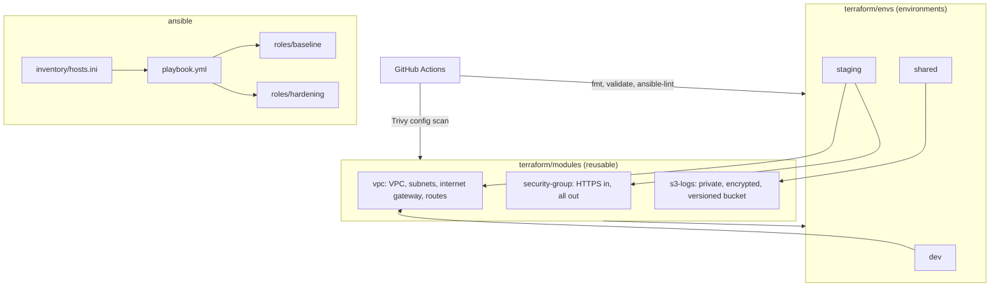

<h1 align="center">🏗️ AWS Infrastructure as Code and Hardening Platform</h1>

Reusable Terraform modules and Ansible roles, with every change validated in CI

  
  
  
  
  
  

---

## 🎯 What it is

Infrastructure is written as code, not clicked together in the AWS console. **Terraform** creates the network and storage. **Ansible** configures the servers. **GitHub Actions** checks every change before it is merged.

## 📊 Status

| Area | Status | Evidence |
|---|---|---|
| VPC, security group and S3 log modules | ✅ Validated | `fmt` and `validate` pass in CI |
| Dev, staging and shared environments | ✅ Validated | Environment matrix in `validate.yml` |
| Ansible baseline and hardening roles | ✅ Linted | `ansible-lint` passes in CI |
| Trivy configuration scan | ✅ Running | `iac-scan.yml` reports findings |
| `terraform apply` to a real AWS account | ⏳ Not yet | Planned with a budget alert in place |
| Remote state (S3 and DynamoDB lock) | ⏳ Proposed | See [ADR 0002](docs/adr/0002-remote-state.md) |
| Ansible run against a real server | ⏳ Not yet | Inventory holds a placeholder host |

## 🏗️ Architecture

## 🔁 How a change is checked

1. Change a module, an environment or a role on a branch.
2. Open a pull request. CI runs `terraform fmt -check`, `terraform validate` for dev and staging, and `ansible-lint`.
3. The Trivy scan reports misconfigurations in the log.
4. Merge only when the checks are green. Applying to AWS is a separate, deliberate step.

## 🧩 Repository structure

platform-infra/
├── terraform/
│ ├── modules/
│ │ ├── vpc/ versions.tf, variables.tf, main.tf, outputs.tf
│ │ ├── security-group/ variables.tf, main.tf, outputs.tf
│ │ └── s3-logs/ variables.tf, main.tf, security.tf, outputs.tf
│ └── envs/
│ ├── dev/ calls the vpc module
│ ├── staging/ calls the vpc and security-group modules
│ └── shared/ calls the s3-logs module
├── ansible/
│ ├── ansible.cfg settings: inventory path, roles path, become
│ ├── inventory/hosts.ini the servers, grouped by role
│ ├── playbook.yml applies baseline, then hardening, to group "web"
│ └── roles/
│ ├── baseline/ packages, time sync, login banner
│ └── hardening/ SSH lockdown, fail2ban, unattended upgrades
├── docs/ architecture, security model, cost notes, ADRs
└── .github/workflows/ validate.yml, iac-scan.yml

## 📄 File guide

| File | What it does | Connected to |
|---|---|---|
| `modules/vpc/main.tf` | Creates the VPC, one public subnet per availability zone, an internet gateway and a public route table | Outputs feed the staging security group |
| `modules/vpc/variables.tf` | Inputs: name, CIDR (default `10.0.0.0/16`), zone count (1 to 4, validated) | Set by each environment |
| `modules/vpc/outputs.tf` | Returns the VPC ID and subnet IDs | Used by other modules |
| `modules/security-group/main.tf` | Allows HTTPS (443) from approved ranges and all outbound traffic | Gets its VPC ID from the VPC module |
| `modules/s3-logs/main.tf` | Log bucket with 30 to 90 day expiry | Set by the shared environment |
| `modules/s3-logs/security.tf` | Versioning, AES256 encryption, all public access blocked | Attached to the log bucket |
| `envs/*/main.tf` | Pins the AWS provider, sets the region and calls the modules | Ties modules to real inputs |
| `ansible/playbook.yml` | Applies `baseline` and then `hardening` to hosts in group `web` | Reads the inventory |
| `roles/hardening/tasks/main.yml` | Installs packages, sets `PermitRootLogin no` and `PasswordAuthentication no`, validates `sshd` config, enables fail2ban | Restarts SSH through the handler |
| `roles/hardening/handlers/main.yml` | Restarts SSH only when its config changed | Notified by the hardening tasks |
| `roles/baseline/tasks/main.yml` | Installs chrony, curl and htop, sets the login banner | Runs first in the playbook |
| `.github/workflows/validate.yml` | Formats, validates and lints the code | Runs on every push and pull request |
| `.github/workflows/iac-scan.yml` | Trivy scan of Terraform configuration | Reports findings in the log |

**Languages:** HCL (Terraform), YAML (Ansible and GitHub Actions), INI (inventory), Markdown.

## 💰 Cost and safety rules

- No NAT gateway and no load balancer. Both are billed by the hour, even when idle.
- Set an AWS Budget alert before creating anything.
- Run `terraform destroy` as soon as a practice environment is finished.
- The hardening role disables password logins, so install your SSH key first or you will lock yourself out.

## ⚠️ Known gaps

- Nothing has been applied to AWS yet. Every result so far is validation only.
- The inventory uses a placeholder address (`203.0.113.10`, a documentation range).
- Remote state is proposed, not implemented.

## 🧠 Key decisions

- **Reusable modules:** each network or storage pattern is written once and reused. See [ADR 0001](docs/adr/0001-reusable-modules.md).
- **Harden SSH by default:** password and root logins are the most common attack path. See [ADR 0003](docs/adr/0003-harden-ssh-by-default.md).
- **Private buckets:** no public access, encryption on, versioning on. See [ADR 0004](docs/adr/0004-private-buckets.md).

## 👤 Author

**Malka Manuranga**, BSc (Hons) Software Engineering, NSBM Green University
[LinkedIn](https://linkedin.com/in/malka-manuranga) · [GitHub](https://github.com/malkamanuranga)